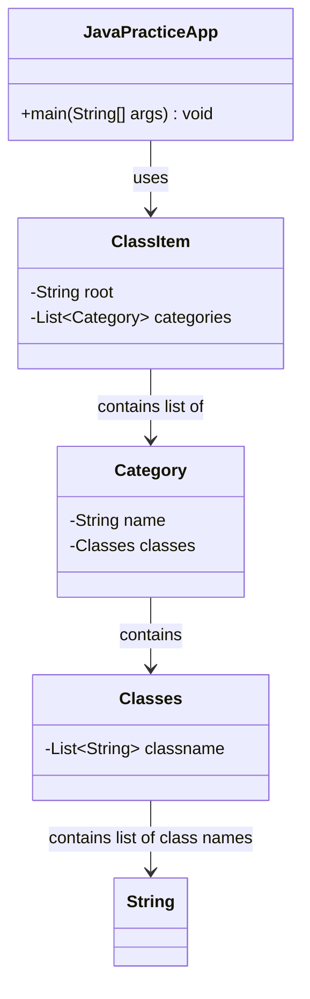

# Java Practice Project

This project contains various examples of Java programming concepts organized into different packages. It serves as a learning resource and reference for Java developers.

## Project Structure

The project is organized into various packages under `in.balamt.practice`, each focusing on a specific Java concept or programming area:

- **algorithms**: Sorting and other algorithmic implementations
- **basics**: Core Java concepts like loops, conditions, and variables
- **casting**: Type casting examples
- **collections**: Examples of Java collection framework (ArrayList, Maps, Sets, etc.)
- **datastructures**: Custom data structure implementations
- **designpattern**: Implementation of various design patterns
- **designprinciple**: Examples of software design principles
- **equal**: Demonstrations of equality in Java
- **exception**: Exception handling concepts
- **funinterface**: Functional interfaces
- **lambda**: Lambda expression examples
- **logical**: Logical programming challenges and solutions
- **serialization**: Object serialization examples
- **stream**: Java Stream API demonstrations
- **string**: String manipulation examples
- **threads**: Multi-threading concepts

## Core Components

The project uses a central launcher mechanism that reads a YAML configuration file to determine which example classes to execute.

### Main Framework Classes

#### JavaPracticeApp

The main entry point for running examples in the project. It loads the configuration from `classeslist.yaml` and dynamically executes the specified classes.

#### ClassItem

Represents the root configuration for the practice examples, containing a root package and a list of categories.

#### Category

Represents a category of examples, with a name (corresponding to a package) and a list of classes.

#### Classes

Contains a list of class names within a category.

## Getting Started

To run examples, add your new class to the appropriate package and update the `classeslist.yaml` file in the resources directory to include your class.
